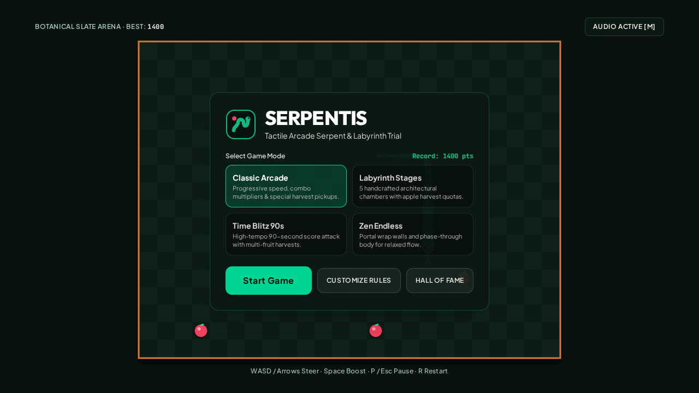
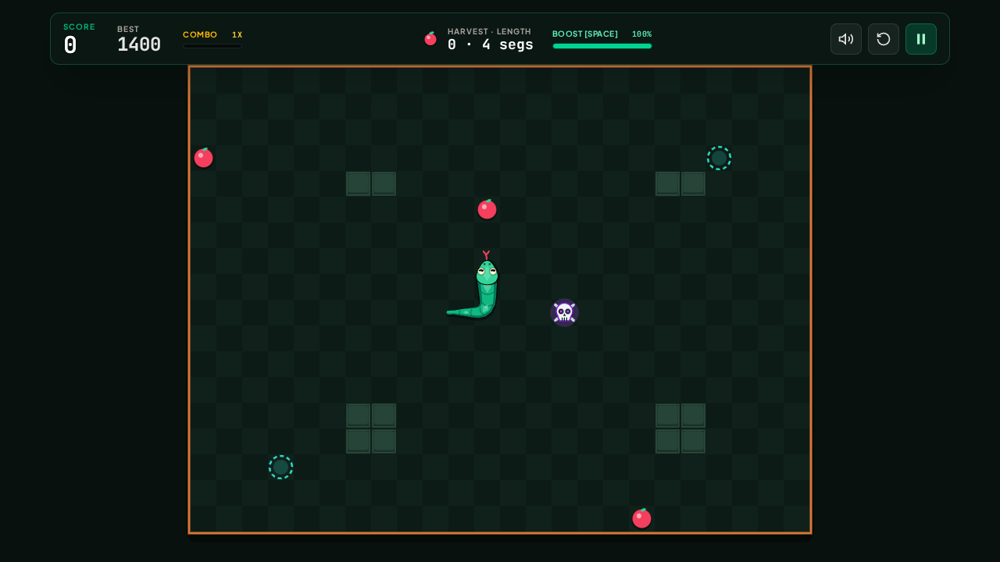
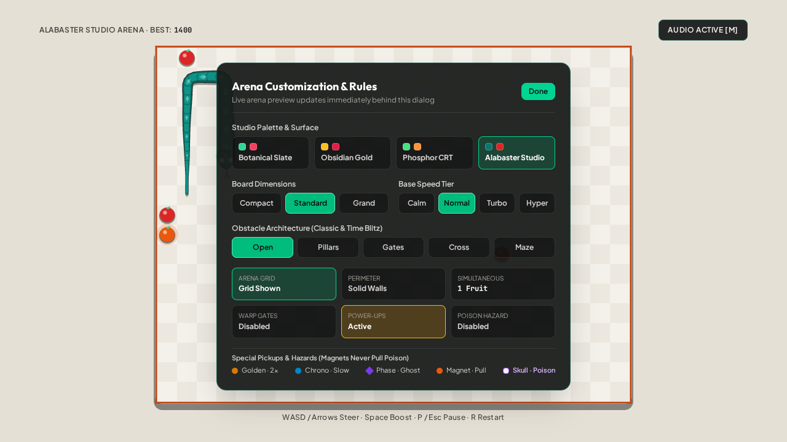

<div align="center">


# SERPENTIS

### Tactile Arcade Serpent & Labyrinth Trial

[](https://doctorlestrange.github.io/Serpentis/)

[](https://github.com/DoctorLestrange/Serpentis/actions/workflows/ci.yml)
[](https://github.com/DoctorLestrange/Serpentis/actions/workflows/deploy-pages.yml)
[](https://www.typescriptlang.org/)
[](https://react.dev/)
[](https://developer.mozilla.org/en-US/docs/Web/API/Canvas_API)
[](https://tailwindcss.com/)
[](https://vitejs.dev/)
[](./LICENSE)

**Serpentis** is a fast, customizable, studio-grade arcade snake game engineered with a pure deterministic simulation core, **Uniform Quadratic B-Spline** continuous body interpolation, woven 3D reptile scale textures, procedural Web Audio synthesis, handcrafted architectural chambers, and a persistent Hall of Fame — packaged as a zero-backend static web application.

[Play Live Demo](https://doctorlestrange.github.io/Serpentis/) · [Screenshots](#-screenshots) · [Features](#-key-features) · [Game Modes](#-game-modes) · [Controls](#%EF%B8%8F-controls) · [Getting Started](#-getting-started) · [Deployment](#-deployment)

</div>

---

## 📸 Screenshots

| Centered Main Menu (Botanical Slate) | Live Arena with Pillars, Warp Gates & Poison |
| :---: | :---: |
|  |  |

<div align="center">

| Arena Customization & Rules (Alabaster Studio Light Theme) |
| :---: |
|  |

</div>

---

## ✨ Key Features

- **Continuous B-Spline Serpent Rendering** — Replaces blocky grid-stepping with a fluid 60 FPS Uniform Quadratic B-Spline spine, layered 3D dorsal shading, diamond reptile scales, an articulated viper head with reactive gaze tracking toward the nearest edible fruit, and a flickering forked tongue.
- **Deterministic Fixed-Tick Simulation & 3-Input Turn Queue** — Buffers rapid orthogonal cornering inputs (`WASD` / `Arrow Keys`) up to 3 turns ahead while strictly preventing accidental 180-degree self-reversal within the same simulation step.
- **4 Distinct Game Modes** — Play **Classic Arcade**, **Labyrinth Stages** (5 progressive architectural chambers with harvest quotas), **Time Blitz 90s**, or **Zen Endless**.
- **Deep Rule Customization** — Configure board dimensions (`Compact 18×14`, `Standard 24×18`, `Grand 30×22`), base speed tiers (`Calm`, `Normal`, `Turbo`, `Hyper`), obstacle presets (`Open`, `Pillars`, `Gates`, `Cross`, `Maze`), perimeter behavior (`Solid Walls` vs `Portal Wrap`), simultaneous multi-fruit counts (`1`, `3`, or `5`), paired warp gates, special power-ups, and lethal poison hazards.
- **Seamless No-Grid Mode** — Toggle the arena checkerboard grid off in Settings or directly from the Pause Menu (`Hide Grid`) for a clean, organic surface and elevated spatial challenge.
- **Tactical Power-Ups & Toxic Poison Skulls** — Harvest **Golden**, **Chrono**, **Phase**, and **Magnet** pickups while evading lethal **Poison Skulls** (automatically active on `Turbo`/`Hyper` difficulties or toggled manually; strictly disabled in Zen Endless). Magnets never pull poison.
- **Persistent Hall of Fame & Quick-Select Names** — Record high-score runs at the end of every game by typing a name or tapping any previously saved player chip. Automatically commits your entry if you click **Try Again** or close the dialog.
- **Zero-Dependency Procedural Web Audio** — Native Web Audio API synthesizer producing tactile harvest chimes, combo arpeggios, warp whooshes, boost hums, and collision thuds with zero external audio files.
- **Desktop & Mobile Ready** — Centered single-dialog navigation, automatic pause on background tab switch, React Error Boundary recovery, responsive mobile viewport scaling, on-screen D-Pad + Boost controls, and touch swipe steering.

---

## 🎨 Visual Themes

| Theme | Aesthetic | Surface Tone |
| :--- | :--- | :--- |
| **Botanical Slate** | Deep emerald slate with terracotta borders and jade viper scales | Dark |
| **Obsidian Gold** | Matte obsidian arena with gilded amber accents and molten highlights | Dark |
| **Phosphor CRT** | High-contrast retro emerald phosphor vector display | Dark |
| **Alabaster Studio** | Warm architectural paper surface with crisp teal-emerald contrast | Light |

---

## 🎮 Game Modes

| Mode | Objective & Mechanics |
| :--- | :--- |
| **Classic Arcade** | Progressive speed scaling as your harvest grows, combo streak multipliers, customizable obstacle layouts, and special pickups. |
| **Labyrinth Stages** | Conquer **5 handcrafted architectural chambers** (*Emerald Meadow*, *Twin Monoliths*, *Sanctum Gates*, *Crossroads Vault*, and *Sovereign Labyrinth*) by reaching each chamber's apple harvest quota. |
| **Time Blitz 90s** | High-tempo 90-second score attack with simultaneous multi-fruit spawns, Golden `+5s` time bonuses, and rapid combo chains. |
| **Zen Endless** | Relaxed flow state with portal-wrapped perimeter walls, phase-through self-collision immunity, and zero lethal hazards. |

---

## 🍎 Pickups & Hazards

| Item | Visual Cue | Effect |
| :--- | :--- | :--- |
| **Crimson Apple** | Glossy red fruit with leaf | `+100` base score (scaled by combo & boost multipliers), `+1` body segment, `+20%` boost stamina. |
| **Golden Fruit** | Radiant gold orb (`2x`) | `+300` base score, `+1` body segment, **2× Double Score** for `8.0s`, and `+5s` bonus time in Time Blitz. |
| **Chrono Berry** | Cyan crystal (`SLOW`) | `+200` base score and **Chrono Dilation** (`38%` slower tick interval) for `6.5s`. |
| **Phase Plum** | Violet diamond (`GHOST`) | `+200` base score and **Ethereal Phase** (pass safely through your own body and interior obstacles) for `6.5s`. |
| **Magnet Citrus** | Amber core (`PULL`) | `+200` base score and **Magnetic Harvest** (pulls beneficial fruits within a 5-tile Manhattan radius) for `7.5s`. **Never pulls Poison Skulls.** |
| **Poison Skull** | Bone skull & crossbones with violet aura | **Lethal Hazard** — Immediately terminates the run on contact. Relocates after `110` ticks. |

---

## 🕹️ Controls

| Action | Desktop (Keyboard) | Mobile / Touch |
| :--- | :--- | :--- |
| **Steer Serpent** | `W A S D` or `Arrow Keys` | On-screen D-Pad (`▲ ◀ ▶ ▼`) or Swipe on Arena |
| **Slither Boost (~1.8× Speed)** | Hold `Space` or `Shift` | Hold on-screen `BOOST` button |
| **Pause / Resume Game** | `P` or `Esc` | Tap Pause (`⏸`) button in top HUD |
| **Quick Restart Run** | `R` | Tap Restart (`↻`) button in top HUD |
| **Mute / Unmute Audio** | `M` | Tap Audio toggle in top HUD or Title Bar |
| **Close Active Dialog** | `Esc` | Tap `Done` or `Close [Esc]` |

---

## 🏗️ Architecture & Project Structure

The codebase strictly separates deterministic game rules from rendering, persistence, and React UI overlays:

```text
.
├── .github/
│   ├── ISSUE_TEMPLATE/              # Structured YAML bug report & feature request forms
│   ├── workflows/
│   │   ├── ci.yml                   # CI pipeline: TypeScript check, unit tests & build verification
│   │   └── deploy-pages.yml         # Automated GitHub Pages static demo deployment
│   ├── PULL_REQUEST_TEMPLATE.md     # Pull request verification checklist
│   └── dependabot.yml               # Automated weekly npm & GitHub Actions dependency updates
├── docs/
│   └── screenshots/                 # Real application screenshots displayed in README
├── public/
│   └── favicon.svg                  # Custom SVG coiled serpent emblem
├── src/
│   ├── components/
│   │   ├── ErrorBoundary.tsx        # Production React Error Boundary with recovery controls
│   │   ├── GameCanvas.tsx           # 60 FPS Canvas2D renderer, batched grid, B-spline serpent & input
│   │   ├── PlayingHud.tsx           # Top telemetry dock & mobile touch D-Pad / Boost controls
│   │   ├── StatusModal.tsx          # Pause dialog, Game Over / Victory summary & Hall of Fame entry
│   │   └── TitleScreen.tsx          # Centered Main Menu, Customize Rules dialog & Hall of Fame
│   ├── game/
│   │   ├── audio.ts                 # Procedural Web Audio API synthesizer with safe unlock
│   │   ├── particles.ts             # Pre-allocated zero-GC particle pool & floating score popups
│   │   ├── rules.ts                 # Pure deterministic simulation engine, turn queue & obstacle builders
│   │   ├── rules.test.ts            # 14 unit tests verifying simulation invariants & persistence
│   │   ├── storage.ts               # Sanitized localStorage persistence, Hall of Fame & achievements
│   │   ├── themes.ts                # 4 curated studio palettes (3 dark + 1 light)
│   │   └── types.ts                 # Strict TypeScript interfaces for simulation state, config & profiles
│   ├── App.tsx                      # Root application state machine, tab-blur auto-pause & shortcuts
│   ├── index.css                    # Tailwind CSS v4 setup & typography rules
│   └── main.tsx                     # React 19 DOM entry point wrapped in ErrorBoundary
├── CHANGELOG.md                     # Semantic release notes
├── CODE_OF_CONDUCT.md               # Contributor Covenant v2.1
├── CONTRIBUTING.md                  # Architecture guidelines & PR workflow
├── LICENSE                          # Apache License 2.0
├── SECURITY.md                      # Security policy & client-side privacy posture
├── index.html                       # HTML5 entry point with SEO / OpenGraph metadata
├── package.json                     # Metadata, scripts & minimal production dependencies
├── tsconfig.json                    # Strict TypeScript configuration
└── vite.config.ts                   # Vite bundler config with portable relative base path
```

---

## 🚀 Getting Started

### Prerequisites

- **Node.js** `>= 20.x` (Node 22 LTS recommended)
- **npm** `>= 10.x`

### Local Development

1. **Clone the repository:**
   ```bash
   git clone https://github.com/DoctorLestrange/Serpentis.git
   cd Serpentis
   ```

2. **Install dependencies:**
   ```bash
   npm install
   ```

3. **Start the development server (runs at `http://localhost:3000`):**
   ```bash
   npm run dev
   ```

---

## 🧪 Testing & Verification

Serpentis includes a deterministic unit test suite (`node:test` via `tsx`) covering turn-queue buffering, 180-degree reversal prevention, growth interpolation alignment, magnet multi-fruit pulls, poison skull immunity, Zen mode hazard safety, solid-wall demo AI navigation, portal clearance, full-board victory edge cases, campaign quotas, and `localStorage` schema sanitization.

```bash
# Run full verification suite (typecheck + unit tests + production build)
npm run check

# Or run individual commands:
npm run lint     # TypeScript strict check (tsc --noEmit)
npm test         # Run all 14 deterministic unit tests
npm run build    # Compile static production bundle into ./dist
npm run preview  # Preview the production bundle locally
```

---

## 🌐 Deployment

Serpentis compiles to a purely static, zero-backend production bundle in `dist/` using portable relative asset paths (`./assets/...`, `./favicon.svg`), so it deploys cleanly to subpaths and root domains alike.

### GitHub Pages (Automated Live Demo)

This repository includes [`.github/workflows/deploy-pages.yml`](./.github/workflows/deploy-pages.yml), which automatically runs typechecking, unit tests, builds `dist/`, and publishes the live demo on every push to `main` (or manually via **Actions → Deploy Demo to GitHub Pages → Run workflow**).

**One-time GitHub repository setup:**
1. Open your repository on GitHub and go to **Settings → Pages**.
2. Under **Build and deployment → Source**, select **GitHub Actions**.
3. Push to `main` (or trigger the workflow manually from the **Actions** tab). Your live demo will be published at:
   `https://doctorlestrange.github.io/Serpentis/`

### Other Static Hosts (Vercel, Netlify, Cloudflare Pages)

| Setting | Value |
| :--- | :--- |
| **Build Command** | `npm run build` |
| **Output Directory** | `dist` |
| **Environment Variables** | None required |

---

## 🤝 Contributing & Governance

Contributions are warmly welcomed! Please review:

- [Contributing Guidelines](./CONTRIBUTING.md) — Architectural principles, local setup, and PR checklist.
- [Code of Conduct](./CODE_OF_CONDUCT.md) — Community standards.
- [Security Policy](./SECURITY.md) — Privacy posture and private vulnerability reporting.
- [Changelog](./CHANGELOG.md) — Version history.

---

## 📄 License

Distributed under the **Apache License 2.0**. See [`LICENSE`](./LICENSE) for full details.
